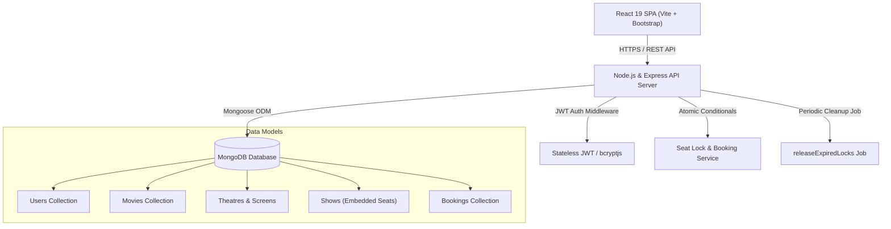

<div align="center">

# 🎬 IMovies
### Online Movie Ticket Booking & Cinema Reservation Platform

[-e50914?style=for-the-badge&logo=react)](https://react.dev)
[](https://vitejs.dev)
[](https://nodejs.org)
[](https://www.mongodb.com)
[](https://jwt.io)
[](LICENSE)

*A full-stack, enterprise-grade cinema ticketing system built according to strict Software Requirements Specifications (SRS v1.0). Features real-time atomic seat reservations, 5-minute countdown holds to prevent double-booking, multiplex show schedules, mock payment gateway, printable QR e-tickets, and an administrative control center.*

[Explore Features](#-features) • [System Architecture](#-system-architecture) • [Demo Walkthrough](#-demo-video--preview) • [Quickstart Guide](#-quickstart-guide) • [API Reference](#-rest-api-specification)

---

</div>

## 📽️ Demo Video & Preview

> Experience smooth seat selection, atomic race condition prevention, and digital QR boarding passes.

<div align="center">
  
</div>

---

## ✨ Features

### 🍿 For Movie-Goers (Customers)
- **Cinematic Discovery**: Discover trending premieres, search by title, cast, or director, and filter by genre (*Action, Sci-Fi, Thriller, Animation, etc.*) and audio language.
- **Multiplex Showtimes**: Filter shows by city (*Mumbai, Bengaluru, Delhi NCR*) and date with real-time auditorium formats (*IMAX Laser 3D, Dolby Atmos 4K, Onyx Cinema LED*).
- **Interactive Seat Map**:
  - Realistic curved cinema screen projection with ambient glow reflection.
  - Color-coded seat states: 🟢 **Available**, 🔵 **Selected**, 🟠 **Locked (In Checkout)**, ⚪ **Booked**.
  - Multi-tier seat categories (*Recliner, Premium, Regular*) with live running subtotal calculation.
- **Atomic 5-Minute Seat Lock**:
  - Automatically isolates chosen seats exclusively to the user's account for 5 minutes during checkout.
  - Real-time countdown timer alerts the user if session is expiring.
  - Released holds are automatically returned to public availability.
- **Digital E-Tickets with QR Code**:
  - Instant generation of unique references (`IMV-XXXX-XXXX`) and high-resolution SVG QR codes for contactless entrance.
  - Printable / savable e-ticket boarding pass.
- **Flexible Cancellations**:
  - Cancel tickets up to 2 hours before showtime with automatic seat release and simulated refund.

### 🛡️ For Cinema Operators (Admin Portal)
- **Live Business Dashboard**: Aggregated gross box office revenue, ticket volume, active titles, and top-selling movies leaderboard.
- **Catalogue CRUD**: Create, edit, and delete movies with high-res posters, official YouTube trailer embeds, runtimes, and ratings.
- **Theatres & Auditoriums**: Configure multiplex venues and build custom row/seat grids.
- **Schedule Overlap Prevention**: Algorithmically detects and blocks conflicting showtimes scheduled on the same auditorium screen.
- **Transaction Ledger**: Filter and audit all customer reservations across the platform.

---

## 🏗️ System Architecture



---

## 🔒 Atomic Double-Booking Prevention

Concurrency safety is guaranteed at the database level using a single atomic conditional update:

```javascript
// Atomically locks seats only if NONE of the requested seats are booked or held by another user
const updateResult = await Show.updateOne(
  {
    _id: showId,
    seats: {
      $not: {
        $elemMatch: {
          seatId: { $in: seatIds },
          $or: [
            { status: 'booked' },
            {
              status: 'locked',
              lockedBy: { $ne: userId },
              lockExpiresAt: { $gt: new Date() },
            },
          ],
        },
      },
    },
  },
  {
    $set: {
      'seats.$[elem].status': 'locked',
      'seats.$[elem].lockedBy': userId,
      'seats.$[elem].lockExpiresAt': lockExpiresAt,
    },
  },
  {
    arrayFilters: [{ 'elem.seatId': { $in: seatIds } }],
  }
);
```

Two simultaneous requests for the exact same seat will strictly result in **exactly one 200 OK and one 409 Conflict** (`unavailable: [...]`).

---

## 🔑 Pre-Configured Test Credentials

| Role | Email | Password | Privileges |
| :--- | :--- | :--- | :--- |
| **Cinema Admin** | `admin@imovies.com` | `Admin@12345` | Complete platform operator controls |
| **Customer Demo** | `user@imovies.com` | `User@12345` | Ticket reservations, live seat map, e-tickets |

*(Tip: 1-click login buttons are provided directly on the `/login` screen)*

---

## 📋 REST API Specification

### 🔐 Authentication & Users
| Method | Endpoint | Access | Description |
| :--- | :--- | :--- | :--- |
| `POST` | `/api/auth/register` | Public | Register new customer account |
| `POST` | `/api/auth/login` | Public | Login with email/password and obtain JWT token |
| `GET` | `/api/auth/me` | User | Get current logged-in profile |
| `PUT` | `/api/users/me` | User | Update profile name and password |

### 🎬 Movies & Showtimes
| Method | Endpoint | Access | Description |
| :--- | :--- | :--- | :--- |
| `GET` | `/api/movies` | Public | List movies with pagination, genre, language, status filters |
| `GET` | `/api/movies/:id` | Public | Detailed movie synopsis, cast, rating |
| `GET` | `/api/movies/:id/shows` | Public | Showtimes grouped by theatre & date |
| `POST` | `/api/movies` | Admin | Create movie in catalogue |
| `PUT` | `/api/movies/:id` | Admin | Update movie details |
| `DELETE`| `/api/movies/:id` | Admin | Delete movie |

### 🎟️ Seats & Bookings
| Method | Endpoint | Access | Description |
| :--- | :--- | :--- | :--- |
| `GET` | `/api/shows/:id` | Public | Fetch live seat map for auditorium show |
| `POST` | `/api/shows/:id/lock` | User | Atomically hold seats for 5 minutes |
| `POST` | `/api/shows/:id/unlock` | User | Explicitly release held seats |
| `POST` | `/api/bookings` | User | Confirm booking and execute mock payment |
| `GET` | `/api/bookings/my` | User | Customer reservation history |
| `GET` | `/api/bookings/:id` | User | View digital e-ticket with QR code |
| `PUT` | `/api/bookings/:id/cancel`| User | Cancel booking (up to 2h before show) |

### 📊 Admin Portal
| Method | Endpoint | Access | Description |
| :--- | :--- | :--- | :--- |
| `GET` | `/api/admin/stats` | Admin | Box office revenue, top movies, booking stats |
| `GET` | `/api/admin/bookings` | Admin | Filterable platform reservation ledger |
| `POST` | `/api/shows` | Admin | Schedule show with collision/overlap validation |
| `POST` | `/api/theatres` | Admin | Create multiplex venue |

---

## 🚀 Quickstart Guide

### 1. Clone the repository
```bash
git clone https://github.com/parv55555/imovies.git
cd imovies
```

### 2. Install dependencies
```bash
npm run install:all
```

### 3. Setup environment variables
Create `.env` inside `server/`:
```env
PORT=5000
MONGO_URI=mongodb://localhost:27017/imovies
JWT_SECRET=your_jwt_secret_key_here
JWT_EXPIRES_IN=1d
CLIENT_URL=http://localhost:5173
SEAT_LOCK_MINUTES=5
```

Create `.env` inside `client/`:
```env
VITE_API_URL=http://localhost:5000/api
```

### 4. Seed sample data
Populates 9 blockbuster movies, 3 theatres, 6 screens, 36 shows, and demo accounts:
```bash
npm run seed
```

### 5. Run Concurrency Suite
```bash
cd server
node test/test-concurrency.js
```

### 6. Start Development Servers
```bash
# In project root:
npm run dev
```

- **Client App**: [http://localhost:5173](http://localhost:5173)
- **API Server**: [http://localhost:5000](http://localhost:5000)

---

## 📄 License
This project is licensed under the MIT License.
